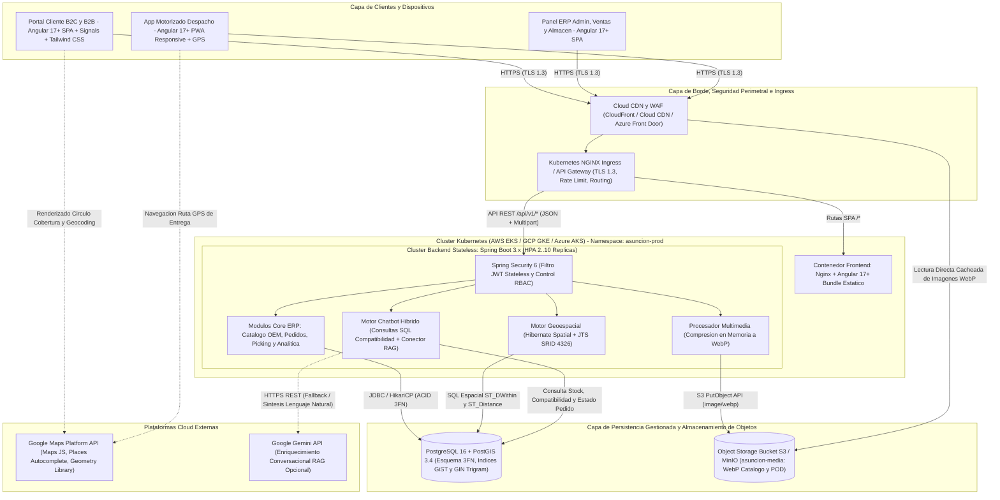
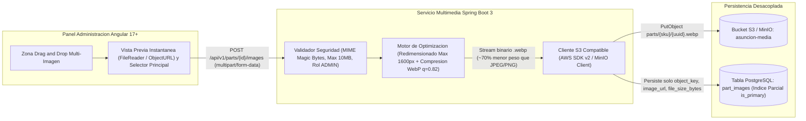

# Entregable 1: Arquitectura de Software Empresarial Cloud-Ready — Repuestos Automotrices Asunción

## 1. Visión Ejecutiva y Principios Arquitectónicos

La plataforma empresarial **"Repuestos Automotrices Asunción"** ha sido concebida bajo una arquitectura **Cloud-Native, Desacoplada, Modular y Sin Estado (Stateless)** que unifica en un solo ecosistema transaccional tres capacidades críticas del negocio automotriz:

1. **Core ERP & Analítica Ejecutiva**: Gestión técnica de autopartes (códigos OEM, SKU, márgenes comerciales, compatibilidad vehicular multivariable $N:M$, alertas de stock mínimo), ranking dinámico de vendedores frente a cuotas mensuales y análisis de rotación de inventario con cálculo de capital inmovilizado.
2. **E-Commerce B2C / B2B de Alto Rendimiento**: Catálogo predictivo indexado con trigramas (`pg_trgm`), galería multimedia de alta resolución optimizada en formato **WebP**, asistente conversacional híbrido (consultas determinísticas SQL + enriquecimiento opcional vía Google Gemini API) y flujo de checkout transparente con facturación diferenciada (`BOLETA` / `FACTURA`).
3. **Motor Geoespacial y Orquestación Logística de Última Milla**: Delimitación paramétrica de cobertura mediante círculos dinámicos en **Google Maps Platform**, validación geodésica estricta en servidor con **PostgreSQL 16 + PostGIS 3.4** (`GEOGRAPHY(Point, 4326)` e índices espaciales `GiST`), tablero independiente de *picking* para almacén (`ALMACENERO`) y aplicación web progresiva (**PWA**) para repartidores (`MOTORIZADO`) con navegación GPS y captura de comprobantes fotográficos (*Proof of Delivery*).

### Adherencia a *The Twelve-Factor App* y Portabilidad Multi-Cloud

| Principio Arquitectónico | Implementación Concreta en "Repuestos Automotrices Asunción" |
| :--- | :--- |
| **Procesos Stateless** | El backend en **Spring Boot 3** no almacena sesiones HTTP en memoria ni archivos en disco local. La autenticación opera mediante **JWT Stateless** (Spring Security 6), permitiendo escalar horizontalmente de $2$ a $N$ réplicas sin afinidad de sesión (*sticky sessions*). |
| **Desacoplamiento Multimedia** | Ningún binario (`BYTEA` / `BLOB`) ingresa a PostgreSQL. Las imágenes de repuestos y evidencias de entrega se transcodifican en memoria a `image/webp` y se persisten vía API compatible con **S3** (**AWS S3** en producción o **MinIO** en contenedores). |
| **Configuración Externalizada** | Credenciales, cadenas JDBC, endpoints S3, claves JWT y llaves de Google Maps/Gemini se inyectan exclusivamente por variables de entorno (`ConfigMap` y `Secret` en Kubernetes). |
| **Paridad Dev / Prod** | Imágenes OCI inmutables orquestadas localmente con `docker-compose.yml` (PostGIS 16-3.4 + MinIO + Spring Boot + Nginx/Angular) y desplegadas de forma idéntica en **AWS EKS**, **GCP GKE** o **Azure AKS**. |
| **Integridad Transaccional y Espacial** | Esquema relacional estrictamente normalizado en **Tercera Forma Normal (3FN)** con validación espacial `ST_DWithin` ejecutada dentro de la misma frontera transaccional ACID que reserva el inventario. |

---

## 2. Diagrama de Arquitectura Cloud-Ready & Contenedores (Vista C4 de Contenedores)

El siguiente diagrama ilustra la topología completa de contenedores, protocolos de comunicación y desacoplamiento entre la capa cliente, el clúster de aplicaciones, el motor relacional-espacial y los servicios externos en la nube:



---

## 3. Diagrama de Secuencia End-to-End: Checkout Geoespacial y Flujo Logístico

El flujo transaccional implementa una arquitectura de **doble validación geoespacial** (experiencia inmediata en cliente + autoridad criptográfica y espacial en servidor) seguida de la trazabilidad operativa completa entre almacén y reparto motorizado:

```mermaid
sequenceDiagram
    autonumber
    actor C as Cliente (B2C / B2B)
    participant SPA as Angular 17+ SPA (Google Maps SDK)
    participant API as Spring Boot 3 API (JWT + Transaccional)
    participant DB as PostgreSQL 16 + PostGIS 3.4 (GiST)
    participant S3 as Object Storage (AWS S3 / MinIO)
    actor ALM as Operario Almacen (ALMACENERO)
    actor MOT as Repartidor PWA (MOTORIZADO)

    C->>SPA: Selecciona direccion o mueve pin en mapa interactivo
    SPA->>SPA: Pre-valida distancia esferica con Google Maps Geometry vs Circulo de Sucursal
    SPA-->>C: Feedback visual instantaneo (< 5ms): Cobertura Valida y Tarifa Estimada

    C->>SPA: Confirma Checkout (BOLETA/FACTURA + Metodo de Pago)
    SPA->>API: POST /api/v1/orders (Bearer JWT + lat, lng, branchId, items)

    API->>DB: SELECT * FROM fn_validate_delivery_coverage(lat, lng, branchId)
    Note over DB: Indice GiST filtra Bounding Box O(log N) y ST_DWithin calcula distancia WGS84 exacta

    alt Punto fuera del radio permitido (is_covered = false)
        DB-->>API: is_covered = false, distance_meters > allowed_radius_meters
        API-->>SPA: HTTP 422 Unprocessable Entity (Direccion fuera del radio de cobertura)
        SPA-->>C: Alerta de cobertura rechazada; ofrece Retiro en Tienda (PICKUP)
    else Punto dentro del radio permitido (is_covered = true)
        DB-->>API: is_covered = true, distance_meters, estimated_fee
        API->>DB: BEGIN TX -> Bloquea y descuenta stock (parts), inserta orders, order_items y history (CONFIRMADO)
        DB-->>API: COMMIT exitoso (order_number generado)
        API-->>SPA: HTTP 201 Created (Resumen de Orden CONFIRMADO)
    end

    ALM->>API: GET /api/v1/warehouse/orders?status=CONFIRMADO
    API-->>ALM: Lista de pedidos pendientes de picking con ubicacion de pasillo (warehouse_location)
    ALM->>API: PATCH /api/v1/warehouse/orders/{id}/pick (Marca items picked=true -> LISTO_PARA_DESPACHO)
    API->>DB: Actualiza order_items.picked, orders.status y registra order_status_history

    MOT->>API: GET /api/v1/driver/orders/assigned (PWA Motorizado)
    API-->>MOT: Pedidos en LISTO_PARA_DESPACHO con coordenadas WGS84 de destino
    MOT->>API: PATCH /api/v1/driver/orders/{id}/start-route (Transicion a EN_RUTA)
    MOT->>MOT: Navega con ruta GPS hacia punto de entrega y entrega repuestos al receptor
    MOT->>API: POST /api/v1/driver/orders/{id}/deliver (Multipart Foto Recepcion + GPS + DNI Receptor)
    API->>API: Comprime fotografia de evidencia a formato WebP en memoria
    API->>S3: PutObject deliveries/{orderNumber}/pod.webp en bucket asuncion-media
    S3-->>API: Confirmacion ETag y URL publica/firmada
    API->>DB: Inserta delivery_proofs (captured_location), cambia orders.status a ENTREGADO
    API-->>MOT: HTTP 200 OK (Despacho cerrado exitosamente)
```

---

## 4. Diagrama de Flujo Multimedia Desacoplado (Compresión WebP + S3 / MinIO)

Para garantizar tiempos de carga inferiores a $1.5\text{ s}$ en conexiones móviles 4G (catálogo de clientes y PWA de motorizados) y preservar una base de datos relacional liviana y respaldable en segundos, el subsistema multimedia desacopla por completo el procesamiento binario del motor SQL:



### Ventajas Clave del Diseño Multimedia
- **Reducción de Ancho de Banda y Almacenamiento**: La conversión automática de JPEG/PNG crudos a **WebP** reduce el peso promedio de fotografías técnicas de autopartes entre un **65% y 80%** manteniendo nitidez en grabados de códigos OEM al aplicar *zoom*.
- **Invariante Atómica de Imagen Principal**: El índice único parcial en PostgreSQL (`CREATE UNIQUE INDEX idx_part_single_primary_image ON part_images(part_id) WHERE is_primary = TRUE;`) impide a nivel físico del motor que condiciones de carrera marquen dos imágenes principales para el mismo repuesto.

---

## 5. Desglose Técnico por Capas del Sistema

### 5.1 Capa de Presentación (Angular 17+ Standalone, Signals & Tailwind CSS)
- **Arquitectura Reactiva Fina**: Uso nativo de **Standalone Components**, **Angular Signals** (`signal`, `computed`, `effect`) y *Lazy Loading* por rutas de rol (`/shop`, `/admin`, `/warehouse`, `/driver`), eliminando sobrecarga de módulos monolíticos (`NgModule`) y ciclos de detección innecesarios.
- **Diseño UI con Tailwind CSS**: Sistema de diseño limpio de grado industrial con alto contraste para entornos operativos (almacenes con iluminación variable y pantallas móviles a plena luz del día para motorizados).
- **Integración Google Maps Platform**:
  - `Maps JavaScript API`: Renderizado interactivo de sucursales, marcadores arrastrables y polígonos circulares (`google.maps.Circle`) parametrizados desde `branches.coverage_radius_meters`.
  - `Places API`: Autocompletado predictivo de direcciones restringido al territorio nacional (`componentRestrictions: { country: 'pe' }`).
  - `Geometry Library`: Pre-cálculo esférico instantáneo (`computeDistanceBetween`) sincronizado con Signals para habilitar o bloquear reactivamente el botón de despacho a domicilio.

### 5.2 Capa de Aplicación y Dominio (Java 21 + Spring Boot 3.x)
Organizada bajo una estructura modular limpia por dominios funcionales:
- `security`: Filtro `JwtAuthenticationFilter`, `SecurityFilterChain` Stateless, codificación `BCryptPasswordEncoder` y autorización declarativa `@PreAuthorize`.
- `catalog`: Gestión CRUD de repuestos, categorías, marcas fabricantes, vehículos compatibles ($N:M$) y búsqueda multicriterio por marca, modelo, año y código OEM.
- `media`: Pipeline de validación de cabeceras binarias, optimización a **WebP** y adaptador de almacenamiento S3/MinIO (`StoragePort`).
- `geospatial`: Integración de **Hibernate Spatial** con `org.locationtech.jts.geom.Point` (`SRID = 4326`) e invocación transaccional de `fn_validate_delivery_coverage`.
- `orders & logistics`: Máquina de estados determinística (`PENDIENTE` → `CONFIRMADO` → `EN_PREPARACION` → `LISTO_PARA_DESPACHO` → `EN_RUTA` → `ENTREGADO` / `CANCELADO`), reserva pesimista/atómica de inventario y auditoría en `order_status_history`.
- `analytics`: Proyecciones de solo lectura sobre `vw_salesperson_ranking` y `vw_inventory_rotation` para el Dashboard Ejecutivo en tiempo real.
- `chatbot`: Motor híbrido que resuelve con precisión exacta consultas estructuradas (compatibilidad por vehículo/año, disponibilidad de stock en tiempo real y rastreo de `order_number`) sobre PostgreSQL, complementado opcionalmente con síntesis en lenguaje natural mediante **Google Gemini API**.

### 5.3 Capa de Persistencia Relacional-Geoespacial (PostgreSQL 16 + PostGIS 3.4)
- **Normalización Estricta en 3FN**: 16 tablas sin redundancia transitiva (detalle completo en `database/01_schema_3fn_postgis.sql`).
- **Indexación Especializada**:
  - **GiST (`Generalized Search Tree`)** sobre columnas `GEOGRAPHY(Point, 4326)` en `branches`, `orders` y `delivery_proofs` para poda espacial en tiempo logarítmico $\mathcal{O}(\log N)$.
  - **GIN con `pg_trgm`** sobre `parts(sku)`, `parts(oem_code)` y `parts(name)` para búsquedas parciales `ILIKE '%0K240%'` y tolerancia tipográfica en milisegundos.
  - **B-Tree Compuestos** sobre `part_vehicle_compatibilities(model_id, year_start, year_end)` y `orders(status, created_at DESC)`.

---

## 6. Seguridad y Control de Accesos Basado en Roles (Matriz RBAC)

Toda petición hacia `/api/v1/**` (excepto endpoints públicos de lectura del catálogo, validación previa de cobertura, chatbot público y `/api/v1/auth/**`) exige un token **Bearer JWT** firmado con `HMAC-SHA256` (o `RS256` en despliegues federados), cuyos *claims* contienen `sub` (email), `uid` (ID de usuario), `roles` y marcas `iat` / `exp`.

| Módulo / Operación de Negocio | `ADMIN` | `VENDEDOR` | `ALMACENERO` | `MOTORIZADO` | `CLIENTE` |
| :--- | :---: | :---: | :---: | :---: | :---: |
| Navegación de catálogo, filtros vehiculares y validación de cobertura | ✅ | ✅ | ✅ | ✅ | ✅ |
| Gestión CRUD de repuestos, precios de compra/venta y carga WebP | ✅ | ❌ *(Solo lectura)* | ❌ *(Solo lectura)* | ❌ | ❌ |
| Configuración de sucursales, radios de cobertura (`meters`) y tarifas | ✅ | ❌ | ❌ | ❌ | ❌ |
| Gestión de usuarios internos, asignación de roles y cuotas mensuales | ✅ | ❌ | ❌ | ❌ | ❌ |
| Dashboard Ejecutivo: Ranking de vendedores y rotación de inventario | ✅ | ✅ *(Vista comercial)* | ❌ | ❌ | ❌ |
| Creación de pedidos y checkout geoespacial (`DELIVERY` / `PICKUP`) | ✅ | ✅ *(Asistido B2B/B2C)* | ❌ | ❌ | ✅ *(Propio)* |
| Panel de Almacén: Picking de ítems y pase a `LISTO_PARA_DESPACHO` | ✅ | ❌ | ✅ | ❌ | ❌ |
| Panel PWA Motorizado: Ruta GPS, foto POD WebP y pase a `ENTREGADO` | ✅ | ❌ | ❌ | ✅ *(Asignados)* | ❌ |
| Chatbot de asistencia técnica, stock compatible y rastreo de pedido | ✅ | ✅ | ✅ | ✅ | ✅ |

---

## 7. Observabilidad, Resiliencia y Escalabilidad Horizontal (HPA)

1. **Sondas de Salud Nativas en Kubernetes**:
   - `startupProbe` y `livenessProbe`: Verifican que la JVM y el contenedor Spring Boot respondan sin bloqueos (`/actuator/health/liveness`).
   - `readinessProbe`: Verifica conectividad activa del pool **HikariCP** contra PostgreSQL/PostGIS antes de enrutar tráfico desde el `Service` (`/actuator/health/readiness`).
2. **Autoescalado Horizontal (`HorizontalPodAutoscaler` `autoscaling/v2`)**:
   - Configurado en `k8s/backend-deployment.yaml` con un piso de alta disponibilidad de **2 réplicas** distribuidas en distintas zonas (`podAntiAffinity`) y escalamiento automático hasta **10 réplicas** cuando el uso promedio de CPU supera el **70%** o la memoria supera el **80%** (por ejemplo, durante campañas masivas de mantenimiento vehicular o cierres de flota B2B).
3. **Telemetría y Trazabilidad**:
   - Logs estructurados en JSON hacia `stdout` recolectados por el agente del clúster (Fluent Bit / CloudWatch / Cloud Logging).
   - Métricas Micrometer expuestas en `/actuator/prometheus` (latencia p95 de validación espacial `ST_DWithin`, tasa de conversión de checkout, tiempo de transcodificación WebP y utilización del pool JDBC).

---

## 8. Matriz de Portabilidad Multi-Cloud (AWS / GCP / Azure)

Gracias al uso exclusivo de estándares abiertos (contenedores OCI, Kubernetes API estándar, PostgreSQL 16 + PostGIS y protocolo de objetos S3), la plataforma se despliega sin cambios de código fuente en cualquiera de los tres principales proveedores de nube pública:

| Componente Arquitectónico | Entorno Local (`docker-compose.yml`) | Amazon Web Services (**AWS**) | Google Cloud Platform (**GCP**) | Microsoft **Azure** |
| :--- | :--- | :--- | :--- | :--- |
| **Orquestación de Contenedores** | Docker Compose Engine | **Amazon EKS** | **Google Kubernetes Engine (GKE)** | **Azure Kubernetes Service (AKS)** |
| **Entrega Global, CDN y WAF** | Nginx Reverse Proxy (`:80`) | **Amazon CloudFront + AWS WAF** | **Cloud CDN + Cloud Armor** | **Azure Front Door + Azure WAF** |
| **Ingress / Balanceo L7** | Nginx Proxy `/api` | **AWS ALB Ingress Controller** | **GKE Gateway / Cloud Load Balancing** | **Azure Application Gateway (AGIC)** |
| **Base de Datos Relacional + Espacial** | `postgis/postgis:16-3.4-alpine` | **Amazon RDS for PostgreSQL 16 (PostGIS)** | **Cloud SQL for PostgreSQL 16 (PostGIS)** | **Azure Database for PostgreSQL Flexible Server (PostGIS)** |
| **Almacenamiento Multimedia WebP** | **MinIO** (`asuncion-media`) | **Amazon S3** | **Google Cloud Storage** *(Modo Interoperabilidad S3)* | **Azure Blob Storage** *(Gateway S3 / SDK Adapter)* |
| **Gestión de Secretos y Llaves** | Variables `.env` | **AWS Secrets Manager** | **GCP Secret Manager** | **Azure Key Vault** |
| **Registro de Imágenes OCI** | Docker Local Cache | **Amazon ECR** | **Artifact Registry** | **Azure Container Registry (ACR)** |
| **Observabilidad Centralizada** | Docker Logs + Actuator | **Amazon CloudWatch + AMP/AMG** | **Google Cloud Operations (Monitoring & Logging)** | **Azure Monitor + Container Insights** |
